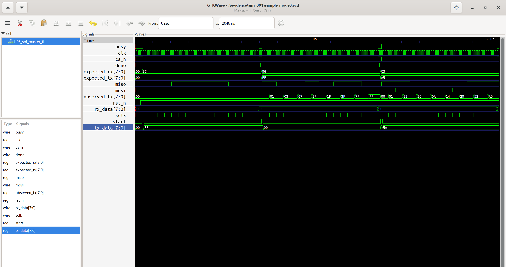

# H03_SPI_Mode0_24101170

Thiết kế SPI Master Mode 0 truyền/nhận đồng thời 8 bit bằng SystemVerilog.

## Kết quả mô phỏng hiện tại

Lần chạy: sim_001.
Cấu hình: clock 100 MHz, HALF_CYCLES=4, MSB-first.

| Byte gửi | Byte nhận từ mô hình slave | Kết quả |
|---|---|---|
| 00 | 3C | PASS |
| FF | 96 | PASS |
| A5 | C3 | PASS |

```text
SIMULATION PASS cases=3 HC=4 ORDER=1
```

Phạm vi: ba ca kiểm thử dữ liệu, kiểm số cạnh SCLK,
thời gian hoàn tất, dữ liệu TX đã chốt và cập nhật RX/DONE.

## Sóng mô phỏng



- [Dữ liệu sóng VCD](evidence/sim_001/sample_mode0.vcd)
- [Log mô phỏng](evidence/sim_001/simulation.log)
- [Mã thoát compiler](evidence/sim_001/compile_exit.txt)
- [Mã thoát simulator](evidence/sim_001/simulation_exit.txt)

## Chạy lại trên Windows PowerShell

Cần iverilog, vvp và gtkwave trong PATH.
Mở PowerShell tại thư mục gốc repository rồi chạy:

```powershell
& {
    $ErrorActionPreference = 'Stop'
    $run = 'evidence/runs/reproduce_001'

    if (Test-Path -LiteralPath $run) {
        throw 'Thu muc run da ton tai. Hay chon ten run moi.'
    }

    New-Item -ItemType Directory -Path $run | Out-Null

    iverilog -g2012 -Wall -s h03_spi_master_tb -o "$run/simulation.vvp" rtl/h03_spi_master.sv tb/h03_spi_master_tb.sv > "$run/compile.log" 2>&1
    $compileExit = $LASTEXITCODE
    Get-Content "$run/compile.log"
    if ($compileExit -ne 0) { throw "Compile failed: $compileExit" }

    vvp "$run/simulation.vvp" "+VCD=$run/sample_mode0.vcd" > "$run/simulation.log" 2>&1
    $simulationExit = $LASTEXITCODE
    Get-Content "$run/simulation.log"
    if ($simulationExit -ne 0) { throw "Simulation failed: $simulationExit" }

    gtkwave "$run/sample_mode0.vcd"
}
```

## Mã nguồn và tài liệu

- [RTL lõi SPI](rtl/h03_spi_master.sv)
- [Testbench](tb/h03_spi_master_tb.sv)
- [Requirements](docs/requirements.md)
- [Specification](docs/specification.md)
- [Phạm vi bài mô phỏng đầu tiên](docs/lesson01_simulation.md)

RTL nền được tái sử dụng từ bản H03_SPI_Mode0_Improved của dự án trước.
Testbench học tập được chuẩn bị cho lần thực hiện này.
