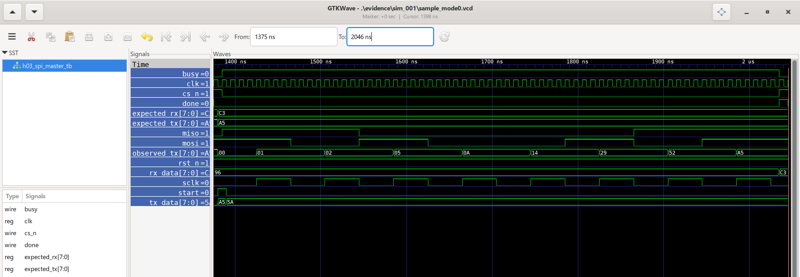

# H03_SPI_Mode0_24101170

Thiết kế SPI Master Mode 0 truyền/nhận đồng thời 8 bit bằng SystemVerilog.

## Kết quả mô phỏng ban đầu — sim_001

Lần chạy: sim_001.
Cấu hình: clock 100 MHz, HALF_CYCLES=4, MSB-first.

| Byte gửi | Byte nhận từ mô hình slave | Kết quả |
|---|---|---|
| 00 | 3C | PASS |
| FF | 96 | PASS |
| A5 | C3 | PASS |

```text
SIMULATION PASS cases=3 HC=4 ORDER=1
```

Phạm vi: ba ca kiểm thử dữ liệu, kiểm số cạnh SCLK,
thời gian hoàn tất, dữ liệu TX đã chốt và cập nhật RX/DONE.

## Sóng mô phỏng


- [Dữ liệu sóng VCD](evidence/sim_001/sample_mode0.vcd)
- [Log mô phỏng](evidence/sim_001/simulation.log)
- [Mã thoát compiler](evidence/sim_001/compile_exit.txt)
- [Mã thoát simulator](evidence/sim_001/simulation_exit.txt)

## Chạy lại trên Windows PowerShell

Cần iverilog, vvp và gtkwave trong PATH.
Mở PowerShell tại thư mục gốc repository rồi chạy:

```powershell
& {
    $ErrorActionPreference = 'Stop'
    $run = 'evidence/runs/reproduce_001'

    if (Test-Path -LiteralPath $run) {
        throw 'Thu muc run da ton tai. Hay chon ten run moi.'
    }

    New-Item -ItemType Directory -Path $run | Out-Null

    iverilog -g2012 -Wall -s h03_spi_master_tb -o "$run/simulation.vvp" rtl/h03_spi_master.sv tb/h03_spi_master_tb.sv > "$run/compile.log" 2>&1
    $compileExit = $LASTEXITCODE
    Get-Content "$run/compile.log"
    if ($compileExit -ne 0) { throw "Compile failed: $compileExit" }

    vvp "$run/simulation.vvp" "+VCD=$run/sample_mode0.vcd" > "$run/simulation.log" 2>&1
    $simulationExit = $LASTEXITCODE
    Get-Content "$run/simulation.log"
    if ($simulationExit -ne 0) { throw "Simulation failed: $simulationExit" }

    gtkwave "$run/sample_mode0.vcd"
}
```

## Mã nguồn và tài liệu

- [RTL lõi SPI](rtl/h03_spi_master.sv)
- [Testbench](tb/h03_spi_master_tb.sv)
- [Requirements](docs/requirements.md)
- [Specification](docs/specification.md)
- [Phạm vi bài mô phỏng đầu tiên](docs/lesson01_simulation.md)

RTL nền được tái sử dụng từ bản H03_SPI_Mode0_Improved của dự án trước.
Testbench học tập được chuẩn bị cho lần thực hiện này.

## Chi tiết frame A5/C3



Cấu hình: HALF_CYCLES=4, MSB-first, chu kỳ clk=10 ns.

Theo VCD của lần chạy sim_001:
- Nhận START, CS xuống thấp tại 1385 ns.
- MOSI tại tám cạnh lên SCLK: 10100101 = A5.
- MISO tại tám cạnh lên SCLK: 11000011 = C3.
- Cạnh xuống SCLK cuối tại 2025 ns; CS vẫn thấp.
- RX cập nhật C3 và DONE lên cao tại 2035 ns.
- Thời gian nhận lệnh đến DONE: 650 ns.


## Kết quả mới nhất — sim_003

Đạt 5 ca kiểm thử, cấu hình HALF_CYCLES=4, MSB-first.
Hai ca bổ sung: TX=96/RX=69 và TX=01/RX=80.

Compiler và simulator đều trả mã thoát 0.

- [Log năm ca PASS](evidence/sim_003/simulation.log)
- [Sóng VCD của năm ca](evidence/sim_003/sample_mode0.vcd)

## GitHub Actions — CI #2

- [Lần chạy SPI Simulation #2](https://github.com/cfm1582006-tech/H03_SPI_Mode0_24101170/actions/runs/40199246063)
- Commit nguồn: `64f0cc54454bb8cba2594f943957b6847b17d430`
- Môi trường: Ubuntu 24.04, Icarus Verilog.
- Kết quả: compile=0, simulation=0, đủ 5 ca PASS.
- Cấu hình: HALF_CYCLES=4, MSB-first, clock mô phỏng 100 MHz.

Bằng chứng được tải từ artifact của lần chạy:
- [Log mô phỏng](evidence/ci_002/simulation.log)
- [Sóng VCD](evidence/ci_002/sample_mode0.vcd)
- [Commit, phiên bản tool và hash nguồn](evidence/ci_002)

## Tái lập và tổng hợp kết quả

- [Kiến trúc lõi](docs/architecture.md)
- [Chạy lại bằng một script và đọc metadata](docs/reproduction.md)
- [Đối chiếu yêu cầu với evidence](docs/verification_matrix.md)

Chạy từ thư mục gốc repository:

```powershell
powershell -NoProfile -ExecutionPolicy Bypass -File .\scripts\run_sim.ps1
```

Kết quả hiện tại thuộc chặng mô phỏng lõi: năm ca ở H=4, MSB-first.
Wrapper và RTL đến GDSII: xem [kết quả macro](docs/physical_results.md). Báo cáo và slide do người học tự thực hiện.

## Wrapper va RTL den GDSII

- [Pinmap va kiem thu wrapper](docs/wrapper.md)
- [Cach chay flow](docs/physical_flow.md)
- [Ket qua va gioi han](docs/physical_results.md)
