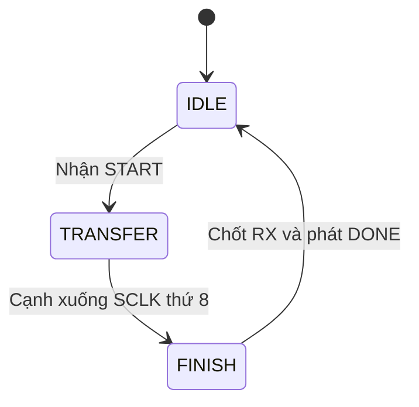

# Architecture — H03_SPI_Mode0_24101170

## 1. Điều khiển bằng FSM

- IDLE: chờ START, giữ CS=1 và SCLK=0.
  Khi nhận START, chốt TX, hạ CS và xuất bit MOSI đầu tiên.
- TRANSFER: tạo SCLK và truyền/nhận đồng thời 8 bit.
- FINISH: cập nhật RX_DATA, nhả CS, hạ BUSY,
  phát DONE trong một chu kỳ clk và trở về IDLE.

Reset đồng bộ tích cực thấp hủy frame và đưa lõi về IDLE.

## 2. Bộ chia xung

Mọi thanh ghi hoạt động theo cạnh lên clk.
SCLK là tín hiệu đầu ra được tạo bởi lõi.

Với HALF_CYCLES=4, half_count đếm từ 0 đến 3.
Trong TRANSFER, SCLK đảo mức sau mỗi 4 chu kỳ clk.

Với chu kỳ clk=10 ns:
- Nửa chu kỳ SCLK: 40 ns.
- Chu kỳ SCLK: 80 ns.
- Tần số SCLK danh định: 12,5 MHz.

## 3. Đường dữ liệu

- tx_shift chốt tx_data khi nhận START.
- Bit MOSI đầu tiên được xuất ngay khi bắt đầu frame.
- Bảy cạnh xuống SCLK đầu tiên dịch sang bảy bit TX còn lại.
- Tám cạnh lên SCLK lấy mẫu MISO vào rx_shift.
- FINISH chuyển rx_shift sang rx_data.
- edge_count đếm số cạnh lên SCLK đã lấy mẫu.

## 4. Liên hệ với evidence

Với cấu hình HALF_CYCLES=4:
- E(0): nhận START và bắt đầu frame.
- E(64): cạnh xuống SCLK cuối, CS vẫn thấp; vào FINISH.
- E(65): thực thi FINISH, RX cập nhật và DONE lên cao.

Độ trễ từ nhận START đến DONE là 65 chu kỳ clk = 650 ns.

Evidence hiện có: năm ca kiểm thử với MSB_FIRST=1.
Xem [log CI](../evidence/ci_002/simulation.log).
